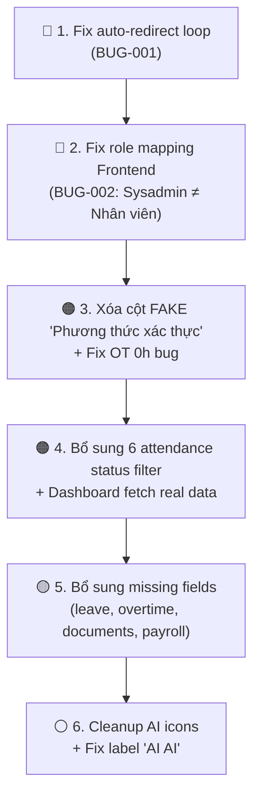

# 🔍 Báo Cáo Kiểm Thử Toàn Diện – HRM Website (localhost:3000)

> **Ngày test:** 26/09/2026  
> **Tài khoản test:** `sysadmin@company.com` (System Administrator)  
> **Phương pháp:** 4 browser agents chạy song song, đối chiếu với [api-reference.md](file:///c:/Users/ad/Desktop/HRM/docs/api-reference.md)  
> **Ponytail mode:** Full – chỉ liệt kê vấn đề thực, không phình prose

---

## 🚨 Mức độ nghiêm trọng

| Ký hiệu | Mức | Mô tả |
|:---:|:---|:---|
| 🔴 | **CRITICAL** | Chặn hoàn toàn chức năng, không sử dụng được |
| 🟠 | **MAJOR** | Sai logic/dữ liệu, ảnh hưởng nghiệp vụ |
| 🟡 | **MINOR** | Thiếu field, UI xấu, nhưng vẫn dùng được |
| ⚪ | **COSMETIC** | Thẩm mỹ, thừa element |

---

## 1. Lỗi Hệ Thống Xuyên Suốt (Cross-cutting)

### 🔴 BUG-001: Auto-redirect loop – Hệ thống tự động chuyển trang liên tục

> [!CAUTION]
> **Blocker nghiêm trọng nhất.** Một script/interval nền liên tục tự động navigate người dùng sang các trang khác (`/attendance` → `/overtime` → `/employees` → `/chat` → `/admin`...) chỉ sau vài giây. Hậu quả: **không thể tương tác thủ công** với bất kỳ trang nào – bộ lọc, search bar, nút bấm đều vô dụng.

- **Trang bị ảnh hưởng:** `/employees`, `/attendance`, `/overtime`, `/resignations`, `/payroll`, `/admin`, `/profile`
- **Giả thuyết:** Có thể là chế độ demo/tutorial tự động (auto-tour) hoặc logic routing bị lỗi vòng lặp
- **Cần fix:** Tìm và xóa/disable script auto-navigation trong frontend code

---

### 🔴 BUG-002: Phân quyền Frontend sai – Sysadmin bị coi là "Nhân viên"

> [!CAUTION]
> Tài khoản `sysadmin@company.com` (department = `Information Technology`, job chứa `System Administrator`) hiển thị trên sidebar: **"Quyền hạn: Nhân viên (Chấm công, xin phép, tra cứu hồ sơ)"**. Theo API spec, System Admin phải có quyền truy cập `/api/admin/*` và xem dữ liệu toàn công ty.

**Hệ quả trực tiếp:**

| Trang | Hành vi mong đợi | Hành vi thực tế |
|:---|:---|:---|
| `/attendance` | View company (`/api/attendances/company`) | Chỉ hiển thị `my-attendances` cá nhân |
| `/payroll` | View company + Generate/Approve/Pay | Chỉ "Phiếu lương của tôi", bị redirect |
| `/admin` | Pending users + Accounts + Sessions | **Không truy cập được**, redirect đi ngay |
| `/leave` | Approvals + Company tabs | Chỉ "Đơn của tôi" |
| `/overtime` | Approvals + Company tabs | Chỉ "Đơn OT của tôi" |
| `/resignations` | Approvals + Company tabs | **Không truy cập được**, redirect đi ngay |

---

### 🟠 BUG-003: Mật khẩu test không khớp

- Mật khẩu `Admin@123` cho `sysadmin@company.com` **không hoạt động**
- Phải dùng mật khẩu mặc định `test@123` hoặc nút đăng nhập nhanh
- Cần đồng bộ mật khẩu seeder với tài liệu

---

### 🟡 BUG-004: Icon AI xuất hiện quá nhiều & lặp lại

- **Menu sidebar:** "Trợ lý AI (RAG) AI" ← chữ "AI" bị lặp 2 lần
- **Nút trôi nổi:** "Hỏi đáp AI" hiển thị ở mọi trang (kể cả trang đã có chat riêng)
- **Dashboard:** Icon sparkle (✨) ở header tiêu đề
- **Khuyến nghị:** Bỏ nút floating "Hỏi đáp AI" (đã có menu link), sửa label "Trợ lý AI (RAG) AI" → "Trợ lý AI"

---

## 2. Từng Trang Chi Tiết

### 2.1 `/login` – Đăng nhập

| # | Mức | Vấn đề |
|:--|:---:|:---|
| 1 | 🟠 | Mật khẩu `Admin@123` không hoạt động (xem BUG-003) |
| 2 | 🟡 | Form auto-fill đôi khi xung đột với React state |

---

### 2.2 `/dashboard` – Tổng quan

| # | Mức | Vấn đề |
|:--|:---:|:---|
| 1 | 🟠 | **Dashboard hiển thị 100% dữ liệu mock** (0 ngày phép, 0 giờ OT, 0 buổi kỷ luật) – không fetch API thực |
| 2 | ⚪ | Icon AI sparkle dày đặc (xem BUG-004) |
| 3 | ✅ | Layout cards gọn gàng, căn lề OK, không vỡ giao diện |

---

### 2.3 `/employees` – Danh bạ Nhân sự

| # | Mức | Vấn đề | Chi tiết |
|:--|:---:|:---|:---|
| 1 | 🔴 | **Không thể test** do auto-redirect (BUG-001) | Trang load xong → tự nhảy sang trang khác sau vài giây |
| 2 | 🟡 | Chế độ hiển thị mặc định là Grid (thẻ card) | Không thể chuyển sang Table mode để verify cột vs API |

**Cột API cần kiểm chứng** (`GET /api/employees`):

```
userId, employeeCode, fullName, profilePicUrl, departmentName, jobTitle, isActive
```

> Chưa verify được do BUG-001. Cần re-test sau khi fix.

---

### 2.4 `/employees/[id]` – Hồ sơ chi tiết & `/profile` – Hồ sơ cá nhân

| # | Mức | Vấn đề |
|:--|:---:|:---|
| 1 | 🔴 | **Không truy cập được** do auto-redirect (BUG-001) |

**Trường API cần verify sau khi fix** (`GET /api/employees/{userId}/detailed`):

```
publicProfile: userId, employeeCode, firstName, lastName, fullName, profilePicUrl,
               gender, birthDate, joinedDate, jobTitle, departmentName, workEmail,
               phoneNumber, todayStatus, shiftName, weeklySchedule, isActive
legalProfile:  citizenIdNumber, taxIdentificationNumber, socialInsuranceNumber, ...
contract:      contractType, contractStartDate, contractEndDate
payroll:       baseSalary, payFrequency, workDays, startDate, bankName, bankAccountNumber
```

---

### 2.5 `/attendance` – Chấm công

| # | Mức | Vấn đề | Chi tiết |
|:--|:---:|:---|:---|
| 1 | 🔴 | **Sai view phân quyền** | Sysadmin chỉ thấy `my-attendances`, không thấy company view (BUG-002) |
| 2 | 🔴 | **Auto-redirect** khi chuyển tab | Bấm "Tổng hợp công tháng" → bị đẩy sang `/chat` hoặc `/overtime` |
| 3 | 🟠 | **Cột dữ liệu "ảo" (FAKE)** | Cột **"PHƯƠNG THỨC XÁC THỰC"** hiển thị "Face ID (98.5%)" – **KHÔNG CÓ** trong API response |
| 4 | 🟠 | **Thiếu 6 trạng thái filter** | Dropdown chỉ có 7/13 trạng thái |
| 5 | 🟡 | Thiếu nút Export | Sysadmin không thấy nút xuất Excel |
| 6 | 🟡 | Thiếu nút/modal Edit attendance | Không có chức năng chỉnh sửa bản ghi chấm công |

**Chi tiết trạng thái filter thiếu:**

| Có ✅ | Thiếu ❌ |
|:---|:---|
| SUFFICIENT, WORKING, LATE | `NOT_CHECKED` |
| PAID_LEAVE, UNPAID_LEAVE | `EARLY` |
| HOLIDAY, ADJUSTED | `LATE_AND_EARLY` |
| | `MISSING` |
| | `UNEXCUSED_ABSENCE` |
| | `BUSINESS_TRIP` |

**So sánh cột bảng vs API** (`GET /api/attendances/my-attendances`):

| Cột trên UI | Có trong API? | Ghi chú |
|:---|:---:|:---|
| Ngày làm việc (workDate) | ✅ | |
| Giờ vào (clockInTime) | ✅ | |
| Giờ ra (clockOutTime) | ✅ | |
| Trạng thái (status) | ✅ | |
| Đã chỉnh sửa (isEdited) | ✅ | |
| Lý do chỉnh sửa (editedReason) | ✅ | |
| **Phương thức xác thực** | ❌ **FAKE** | Cột bịa, API không trả field này |

---

### 2.6 `/leave` – Nghỉ phép

| # | Mức | Vấn đề | Chi tiết |
|:--|:---:|:---|:---|
| 1 | 🔴 | **Sai phân quyền** | Sysadmin chỉ thấy tab "Đơn của tôi", thiếu Approvals + Company (BUG-002) |
| 2 | 🟡 | **Thiếu field hiển thị** | `requestId`, `rejectionReason`, `approverId` không hiển thị trên UI |
| 3 | ✅ | Nút "Nộp đơn xin nghỉ phép" có mặt | |
| 4 | ✅ | Bộ lọc keyword hoạt động | |

**So sánh cột bảng vs API** (`GET /api/leave/my-requests`):

| Trường API | Hiển thị trên UI? |
|:---|:---:|
| `requestId` | ❌ Thiếu |
| `fromDate` + `toDate` | ✅ (gộp thành "Thời gian nghỉ") |
| `reason` | ✅ |
| `rejectionReason` | ❌ Thiếu |
| `paidLeaveDays` | ✅ ("Số ngày trừ phép") |
| `status` | ✅ |
| `createdAt` | ✅ |
| `approverId` | ❌ Thiếu |
| `approverName` | ✅ ("Người duyệt") |
| `approverJob` | ❌ Thiếu |

---

### 2.7 `/overtime` – Tăng ca

| # | Mức | Vấn đề | Chi tiết |
|:--|:---:|:---|:---|
| 1 | 🔴 | **Redirect sai** | URL trực tiếp `/overtime` bị redirect sang `/employees` |
| 2 | 🔴 | **Sai phân quyền** | Chỉ tab "Đơn OT của tôi" (BUG-002) |
| 3 | 🔴 | **Cột "Số giờ" luôn hiển thị 0h** | Dù khung giờ đăng ký hợp lệ (18:00-20:00), cột số giờ vẫn = 0h |
| 4 | 🟡 | **Thiếu field** | `overtimeRecordId`, `approverId` không hiển thị |
| 5 | ✅ | Nút "Đăng ký làm thêm giờ" có mặt | |

**So sánh cột bảng vs API** (`GET /api/overtime/my-records`):

| Trường API | Hiển thị trên UI? | Ghi chú |
|:---|:---:|:---|
| `overtimeRecordId` | ❌ Thiếu | |
| `approvedDate` | ✅ | |
| `approvedStartTime` / `approvedEndTime` | ✅ | "Khung giờ đăng ký" |
| `clockInTime` / `clockOutTime` | ✅ | "Giờ quẹt thẻ" |
| `isHoliday` / `isWeekend` / `isNightTime` | ✅ | "Hệ số & Chế độ" |
| `status` | ✅ | |
| `reason` | ✅ | |
| `rejectionReason` | ❌ Thiếu | |
| `approverId` | ❌ Thiếu | |
| `approverName` / `approverJob` | ✅ | "Người duyệt" |
| *(Tính toán số giờ)* | 🔴 **BUG** | Luôn = 0h |

---

### 2.8 `/resignations` – Thôi việc

| # | Mức | Vấn đề |
|:--|:---:|:---|
| 1 | 🔴 | **Không truy cập được hoàn toàn** – bị redirect sang `/employees` hoặc `/attendance` |

> Không thể verify bất kỳ field, filter, hay button nào. Cần fix BUG-001 + BUG-002 trước.

---

### 2.9 `/payroll` – Bảng lương

| # | Mức | Vấn đề | Chi tiết |
|:--|:---:|:---|:---|
| 1 | 🔴 | **Redirect** | Bị đá sang `/attendance` do sai phân quyền (BUG-002) |
| 2 | 🔴 | **Sai phân quyền** | Chỉ tab "Phiếu lương của tôi", thiếu Company tab |
| 3 | 🟠 | **Thiếu bộ lọc** | Chỉ có filter tháng. Thiếu: năm, trạng thái, keyword, departmentNames |
| 4 | 🟠 | **Thiếu nhiều field** | UI dùng layout summary thay bảng, thiếu nhiều field |
| 5 | 🟠 | **Thiếu nút chức năng** | Generate, Approve, Pay, Export đều không hiển thị |

**Trường API thiếu trên UI** (`GET /api/payrolls/me`):

```
periodYear, hourlyRate, bonusPay, taxDeduction, otherDeduction, 
grossPay, note, paidAt
```

---

### 2.10 `/admin` – Quản trị hệ thống

| # | Mức | Vấn đề |
|:--|:---:|:---|
| 1 | 🔴 | **Không truy cập được hoàn toàn** – redirect sang `/attendance` hoặc `/overtime` |

> Không thể verify Pending Users, Accounts, Sessions. Đây là trang **dành riêng cho Sysadmin** nhưng chính Sysadmin lại không vào được.

---

### 2.11 `/chat` – Trợ lý AI Chatbot

| # | Mức | Vấn đề |
|:--|:---:|:---|
| 1 | ✅ | **Hoạt động tốt** – gửi câu hỏi thành công, streaming SSE hoạt động |
| 2 | ✅ | Danh sách lịch sử hội thoại cập nhật đúng |
| 3 | ⚪ | Label menu: "Trợ lý AI (RAG) **AI**" ← chữ "AI" thừa |

---

### 2.12 `/documents` – Kho tài liệu AI

| # | Mức | Vấn đề | Chi tiết |
|:--|:---:|:---|:---|
| 1 | ✅ | **Hoạt động tốt** – upload, filters (status, search, department) đều work |
| 2 | 🟡 | **Thiếu field** trên UI | `id`, `file_type`, `file_hash`, `error_message` không hiển thị |

**So sánh vs API** (`GET /api/ai/documents`):

| Trường API | Hiển thị? |
|:---|:---:|
| `id` | ❌ |
| `file_name` | ✅ |
| `file_type` | ❌ |
| `file_size` | ✅ |
| `file_hash` | ❌ |
| `uploaded_by` | ✅ |
| `status` | ✅ |
| `file_url` | ✅ |
| `error_message` | ❌ |
| `created_at` | ✅ |
| `updated_at` | ✅ |
| `chunk_count` | ✅ |
| `allowed_departments` | ✅ |

---

## 3. Tổng Hợp Theo Loại Vấn Đề

### 🔴 CRITICAL – Cần fix ngay (8 lỗi)

| # | Mã | Vấn đề | Trang |
|:--|:---|:---|:---|
| 1 | BUG-001 | Auto-redirect loop – script nền tự chuyển trang | Toàn bộ |
| 2 | BUG-002 | Phân quyền FE sai – Sysadmin = "Nhân viên" | Toàn bộ |
| 3 | — | `/admin` không truy cập được (Sysadmin) | `/admin` |
| 4 | — | `/resignations` không truy cập được | `/resignations` |
| 5 | — | `/payroll` redirect đi ngay | `/payroll` |
| 6 | — | Attendance: chỉ thấy my-attendances | `/attendance` |
| 7 | — | Overtime: cột "Số giờ" luôn = 0h | `/overtime` |
| 8 | — | Attendance tab redirect (bấm Tổng hợp → nhảy /chat) | `/attendance` |

### 🟠 MAJOR – Sai logic/dữ liệu (6 lỗi)

| # | Vấn đề | Trang |
|:--|:---|:---|
| 1 | Cột "Phương thức xác thực" FAKE (không có trong API) | `/attendance` |
| 2 | Dashboard 100% mock data | `/dashboard` |
| 3 | Mật khẩu `Admin@123` không hoạt động | `/login` |
| 4 | Payroll thiếu nhiều field + thiếu filters | `/payroll` |
| 5 | Payroll thiếu nút Generate/Approve/Pay/Export | `/payroll` |
| 6 | Attendance thiếu 6 trạng thái filter | `/attendance` |

### 🟡 MINOR – Thiếu field/filter (6 lỗi)

| # | Vấn đề | Trang |
|:--|:---|:---|
| 1 | Thiếu `requestId`, `rejectionReason`, `approverId`, `approverJob` | `/leave` |
| 2 | Thiếu `overtimeRecordId`, `approverId`, `rejectionReason` | `/overtime` |
| 3 | Thiếu `id`, `file_type`, `file_hash`, `error_message` | `/documents` |
| 4 | Thiếu nút Export trên view chấm công | `/attendance` |
| 5 | Thiếu nút Edit attendance | `/attendance` |
| 6 | Payroll thiếu filter năm, trạng thái, keyword | `/payroll` |

### ⚪ COSMETIC – Thẩm mỹ (3 lỗi)

| # | Vấn đề | Trang |
|:--|:---|:---|
| 1 | Icon AI quá nhiều: nút floating "Hỏi đáp AI" xuất hiện mọi trang | Toàn bộ |
| 2 | Label menu "Trợ lý AI (RAG) **AI**" – chữ AI lặp | Sidebar |
| 3 | Một số nút bị đè lên nhau ở certain viewport | Nhiều trang |

---

## 4. Các Trang Hoạt Động Tốt ✅

| Trang | Ghi chú |
|:---|:---|
| `/chat` | Streaming SSE hoạt động, lịch sử hội thoại OK |
| `/documents` | Upload, filters, list đều work (chỉ thiếu vài field hiển thị) |
| `/login` | Chức năng login OK (sau khi dùng đúng password) |

---

## 5. Thứ Tự Ưu Tiên Fix



> **Ước lượng:** BUG-001 + BUG-002 chiếm ~80% các lỗi downstream. Fix 2 cái này trước sẽ unlock khả năng test lại toàn bộ phần còn lại.
